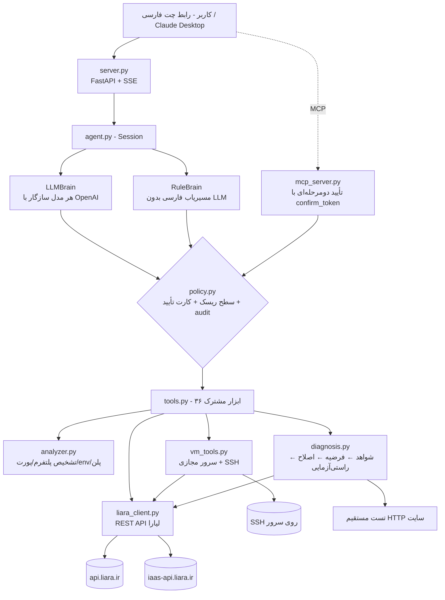

# لیارا کوپایلوت (Liara Copilot)

**دستیار هوشمند DevOps + SRE برای صاحبان وب‌سایت روی لیارا** — از اولین دیپلوی تا پیدا کردن و رفع علت کندی و خطای ۵۰۰، با تأیید انسان برای هر عملیات حساس.

> کاربر فقط می‌نویسد «پروژه‌م رو بالا بیار»، «یک سرور مجازی با docker بساز» یا «سایتم کند شده». دستیار پروژه را تحلیل می‌کند، پلن مناسب را با دلیل پیشنهاد می‌دهد، منتشر می‌کند؛ و وقتی مشکلی پیش می‌آید، شواهد را جمع می‌کند، علت‌ها را با درصد احتمال و «شاهد» رتبه‌بندی می‌کند، با تأیید کاربر اصلاح می‌کند و **دوباره بررسی می‌کند که واقعاً حل شده باشد**.

---

## ۱. قابلیت‌ها در یک نگاه

| بخش چالش | پیاده‌سازی |
|---|---|
| راه‌اندازی و اولین دیپلوی | تحلیل خودکار پروژه (پوشه یا لینک گیت) با قواعد رسمی `liara-cli` ← تشخیص پلتفرم، پورت، متغیرهای محیطی موردنیاز (با محل استفاده در کد) ← پیشنهاد ارزان‌ترین پلن کافی از **لیست واقعی پلن‌های حساب** با دلیل ← کارت تأیید (با فیلد وارد کردن مقدار متغیرها) ← ساخت اپ، تنظیم env، بسته‌بندی، آپلود، build، اجرا ← تست سلامت آدرس نهایی |
| دامنه و ایرنیک | ثبت دامنه روی اپ + راهنمای قدم‌به‌قدم مخصوص nic.ir و جدول دقیق رکوردهای DNS (کاری که از API برنمی‌آید، شفاف به کاربر سپرده می‌شود) |
| مدیریت سرویس (PaaS) | وضعیت، ری‌استارت، روشن/خاموش، **تغییر پلن (منابع)**، تغییر پورت، متغیر محیطی، تاریخچه‌ی ریلیز، rollback |
| سرور مجازی (IaaS) | ساخت سرور با پیشنهاد پلن و سیستم‌عامل، انتظار تا آماده شدن، نمایش IP و رمز root (فقط در رابط کاربری، هرگز به LLM داده نمی‌شود)، روشن/خاموش/ری‌استارت، تغییر پلن، بازنشانی رمز، حذف — و **پیکربندی داخل سرور از طریق SSH** با دستورالعمل‌های آماده (update، امن‌سازی با فایروال و fail2ban، Docker، Nginx، Node.js+PM2، Python، PostgreSQL، Swap) که دستورات دقیقشان قبل از اجرا در کارت تأیید نمایش داده می‌شود |
| پایش | داشبورد زنده‌ی سلامت همه‌ی اپ‌ها و سرورها (کد HTTP، زمان پاسخ، درصد CPU/RAM نسبت به سقف پلن) + «وضعیت همه‌ی اپ‌ها» با یک جمله + گزارش سلامت سرور مجازی (uptime، RAM، دیسک) از طریق SSH |
| عیب‌یابی هوشمند | موتور SRE با ۸ دسته‌ی علت: متغیر محیطی جاافتاده، نشتی/کمبود حافظه، اشباع CPU، ریلیز خراب، وابستگی نصب‌نشده، پورت اشتباه، قطعی دیتابیس، سرویس خاموش — هرکدام با شاهد از لاگ، **رویدادهای پلتفرم لیارا (مثل OOMKilled)**، متریک و تست HTTP، درصد اطمینان، راه‌حل فوری و راه‌حل دائمی در کد (فایل و شماره‌ی خط از stack trace) |
| بررسی نتیجه | ابزار `verify_fix`: جمع‌آوری دوباره‌ی شواهد فقط از لاگ‌های **بعد از اصلاح** و مقایسه‌ی قبل/بعد |
| Human-in-the-Loop | ۴ سطح ریسک؛ عملیات حساس فقط با کارت تأیید (چه می‌شود / اثر و قطعی / راه برگشت). عملیات حذف با تأیید دوباره. Audit log کامل بدون ذخیره‌ی مقدار secretها |
| خروجی | **هم Agent با رابط وب فارسی، هم MCP Server** (برای Claude Desktop / Cursor) روی یک لایه‌ی ابزار مشترک |

---

## ۲. معماری



| فایل | نقش |
|---|---|
| `copilot/liara_client.py` | کلاینت async برای API لیارا؛ تبدیل خطاها به پیام فارسی قابل‌فهم (مثلاً 402 ← «حساب را شارژ کنید») |
| `copilot/analyzer.py` | تحلیل پروژه؛ قواعد تشخیص پلتفرم دقیقاً مطابق `detect-platform.ts` در liara-cli؛ بسته‌بندی سورس بدون `node_modules`, `.git`, `.env` |
| `copilot/diagnosis.py` | موتور SRE قطعی و قابل‌توضیح (هر فرضیه = عنوان + اطمینان + شواهد + راه‌حل + کد) |
| `copilot/policy.py` | سطح‌بندی ریسک، کارت تأیید، audit log با ماسک secretها |
| `copilot/vm_tools.py` | سرورهای مجازی (IaaS) و پیکربندی SSH با دستورالعمل‌های قابل‌بازبینی و فیلتر دستورات خطرناک |
| `copilot/tools.py` | ثبت ابزارها (schema + ریسک + متن تأیید فارسی + پیاده‌سازی) — مشترک بین Agent و MCP |
| `copilot/agent.py` | حلقه‌ی گفت‌وگو؛ اجرای ابزار از مسیر policy؛ دو مغز LLM و قواعد |
| `copilot/server.py` + `web/index.html` | رابط کاربری: چت، تایم‌لاین مراحل زنده، کارت تأیید، کارت تشخیص، کارت قبل/بعد، داشبورد سلامت، audit log |
| `copilot/mcp_server.py` | همان ابزارها به‌صورت MCP |
| `copilot/mock_liara.py` | شبیه‌ساز لیارا برای تست خودکار و تمرین بدون هزینه |
| `victim-app/` | اپ فروشگاهی نمونه با **باگ‌های واقعی** (env جاافتاده ← ۵۰۰، کش بی‌سقف ← نشتی حافظه، محاسبه‌ی سنگین ← CPU) برای دمو روی لیارای واقعی |

**چرا دو مغز؟** هسته‌ی تشخیص قطعی است (قابل‌توضیح، سریع، بدون هزینه و بدون توهم). LLM روی همین ابزارها برای گفت‌وگوی آزاد و استدلال روی موارد خارج از قواعد استفاده می‌شود. اگر کلید LLM نباشد یا سرویس در دسترس نباشد، دستیار با مغز قواعد همچنان همه‌ی سناریوهای اصلی را انجام می‌دهد.

---

## ۳. نحوه‌ی اتصال به APIهای لیارا

- احراز هویت: هدر `Authorization: Bearer <LIARA_API_TOKEN>` (توکن از `console.liara.ir/API`)، آدرس پایه `https://api.liara.ir`، و پارامتر `teamID` برای حساب‌های تیمی (`LIARA_TEAM_ID`).
- تست سریع اتصال (فقط خواندنی): `python -m copilot.smoke <نام-اپ>` — برای هر endpoint ✓ یا ✗ با دلیل.
- همه‌ی endpointها از **مستندات رسمی developers.liara.ir** (و OpenAPI آن) و **سورس رسمی liara-cli** استخراج شده‌اند.
- هر خطای لیارا با **پیام و کد دقیق خود لیارا** به کاربر نمایش داده می‌شود (نه حدس).

**PaaS — `https://api.liara.ir`**

| عملیات | Endpoint | نکته |
|---|---|---|
| حساب و پلن‌ها | `GET /v1/me` ← `plans.projects` و `plans.projectBundlePlans` | فقط پلن‌های **نسل g2** و منطقه‌ی ایران برای ساخت اپ جدید مجازند (همان فیلتر `liara app create`) |
| لیست / جزئیات اپ | `GET /v1/projects`, `GET /v1/projects/{app}` | |
| ساخت اپ | `POST /v1/projects` `{name, planID, platform, bundlePlanID, network}` | بسته‌ی امکانات معتبر برای همان پلن و شبکه‌ی خصوصی خودکار انتخاب می‌شوند (اگر شبکه‌ای نباشد ساخته می‌شود) |
| شبکه‌ها | `GET/POST /v1/networks` | |
| **تغییر پلن** | `POST /v1/projects/{app}/resize` `{planID}` | |
| ری‌استارت / روشن‌خاموش | `POST /v1/projects/{app}/actions/restart`, `.../actions/scale` | |
| تغییر پورت / env | `POST /v1/projects/update-port`, `POST /v1/projects/update-envs` | env کامل جایگزین می‌شود؛ دستیار ابتدا merge می‌کند |
| آپلود سورس / ریلیز | `POST /v2/projects/{app}/sources`, `POST /v2/projects/{app}/releases` | |
| وضعیت و لاگ build | `GET /v1/releases/{id}`, `GET /v2/releases/{id}/build-logs` | |
| ریلیزها | `GET /v1/projects/{app}/releases` | |
| لاگ اپ | `GET /v2/projects/{app}/logs` (با fallback به `GET /v1/projects/{app}/logs`) | |
| **رویدادهای اپ** | `GET /v1/projects/{app}/events` | برای تشخیص OOMKilled، ری‌استارت‌ها و... |
| **متریک CPU/RAM** | `GET /v1/projects/{app}/metrics/summary` ← `cpuUsage`, `memoryUsage`, `disksUsage` | به درصد سقف پلن تبدیل می‌شود |
| دامنه‌ها | `GET/POST /v1/domains` `{name, project, type: "PROJECT"}`, `GET /v1/domains/{id}/check` | |
| Rollback | `POST /v2/projects/{app}/releases/{id}/rollback` | در صورت عدم پشتیبانی، محدودیت اعلام می‌شود |

**IaaS (سرور مجازی) — `https://iaas-api.liara.ir`**

| عملیات | Endpoint |
|---|---|
| پلن‌ها / سیستم‌عامل‌ها | `GET /plans`, `GET /oss` |
| لیست / جزئیات سرور | `GET /vm`, `GET /vm/{id}` |
| ساخت سرور | `POST /vm` `{name, OS, plan, config:{SSHKeys}}` |
| روشن / خاموش / ری‌استارت | `PATCH /vm/power/{id}` `{action: start\|stop\|reboot\|shutdown}` |
| تغییر پلن | `PATCH /vm/resize/{id}` `{plan}` |
| بازنشانی رمز root | `POST /vm/reset-password/{id}` (سرور باید خاموش باشد) |
| عملیات‌ها / حذف | `GET /vm/operation/{id}`, `DELETE /vm/{id}` |

پیکربندی نرم‌افزار داخل سرور از API لیارا انجام نمی‌شود (طبق مستندات، مرحله‌ی جداگانه‌ای است)؛ دستیار با **SSH** (کتابخانه‌ی paramiko) و رمز root همان سرور وصل می‌شود و فقط دستوراتی را اجرا می‌کند که کاربر در کارت تأیید دیده و پذیرفته است.

علاوه بر API، دستیار خودش سایت را با چند درخواست HTTP مستقیم تست می‌کند (کد پاسخ و زمان پاسخ)؛ این همان چیزی است که کاربر واقعی تجربه می‌کند و حتی بدون متریک، کندی و خطا را قابل‌اندازه‌گیری می‌کند.

---

## ۴. محدودیت‌ها (و نحوه‌ی اعلام آن‌ها به کاربر)

| محدودیت | رفتار دستیار |
|---|---|
| **شارژ حساب / پرداخت** از طریق API ممکن نیست و نباید خودکار باشد | خطای 402 به پیام «ابتدا حساب را شارژ کنید» تبدیل می‌شود |
| **پلن‌های قدیمی (غیر g2)** برای ساخت اپ جدید مجاز نیستند | فقط پلن‌های g2 پیشنهاد و پذیرفته می‌شوند؛ اگر پلن نامعتبر درخواست شود، لیست پلن‌های مجاز نمایش داده می‌شود |
| **نرم‌افزار داخل سرور مجازی** از API قابل مدیریت نیست | با SSH و دستورالعمل‌های آماده انجام می‌شود؛ دستورات خطرناک (مثل `rm -rf /`، `mkfs`) مسدودند |
| **بازنشانی رمز root** فقط وقتی سرور خاموش است | دستیار این پیش‌شرط را توضیح می‌دهد و پیشنهاد shutdown می‌دهد |
| **تنظیم DNS در ایرنیک/ثبت‌کننده‌ها** خارج از لیاراست | جدول رکوردها و مراحل nic.ir آماده می‌شود؛ کاربر فقط وارد می‌کند |
| **متریک CPU/RAM** با توکن API در همه‌ی حساب‌ها تضمین‌شده نیست | کارت زرد «محدودیت API» نمایش داده می‌شود و تحلیل با لاگ + تست HTTP ادامه می‌یابد |
| **Rollback مستقیم** در CLI رسمی وجود ندارد | در صورت رد API، محدودیت اعلام و دیپلوی دوباره‌ی نسخه‌ی سالم پیشنهاد می‌شود |
| پایش ۲۴ساعته | طبق صورت چالش الزامی نیست؛ پایش با یک جمله یا دکمه‌ی داشبورد (و قابل زمان‌بندی با cron) انجام می‌شود |
| تشخیص قطعی فقط برای الگوهای شناخته‌شده | برای بقیه، فرضیه‌ی کم‌اطمینان + لاگ‌های مرتبط؛ با LLM فعال، استدلال آزاد روی لاگ‌ها |
| دسترسی به کد | از stack trace فایل و خط استخراج می‌شود؛ با `GITHUB_REPO` لینک مستقیم ساخته می‌شود. اصلاح خودکار کد (ساخت PR) در این نسخه نیست |

---

## ۵. تعامل کاربر با سیستم

1. **فقط بنویسید** (فارسی محاوره‌ای): «پروژه‌ی ‎./victim-app‎ را دیپلوی کن»، «سایت shop-demo کند شده»، «خطای ۵۰۰ می‌دهد»، «وضعیت همه‌ی اپ‌ها»، «دامنه‌ی mysite.ir را وصل کن»، «پلن shop-demo را ارتقا بده»، «یک سرور مجازی بساز اسم my-server و روش docker و nginx نصب کن»، «سلامت سرور my-server».
2. **مراحل را زنده ببینید**: هر مرحله با ⏳/✓/!/✗ در تایم‌لاین نمایش داده می‌شود (مثلاً «۴۸ خط لاگ و ۳ ریلیز بررسی شد»، «وضعیت ریلیز: در حال build» با آخرین خطوط build).
3. **پیشنهاد را ارزیابی کنید**: کارت تشخیص علت‌ها را با درصد احتمال، شاهد، راه‌حل فوری و راه‌حل دائمی (با فایل:خط) نشان می‌دهد.
4. **تأیید کنید**: هر عملیات حساس یک کارت دارد: چه کاری، اثر (قطعی/هزینه)، راه برگشت؛ اگر مقداری لازم است (مثل `DATABASE_URL`) همان‌جا وارد می‌کنید. «انصراف» یعنی هیچ تغییری اعمال نمی‌شود.
5. **نتیجه را ببینید**: کارت «قبل ← بعد» (کد پاسخ و زمان پاسخ) و audit log سمت راست.

سطوح ریسک:

| سطح | نمونه | رفتار |
|---|---|---|
| 🟢 خواندنی | لاگ، وضعیت، متریک، تحلیل پروژه، عیب‌یابی | خودکار |
| 🟡 کم‌ریسک | اتصال دامنه | خودکار + گزارش (در `APPROVAL_MODE=strict` با تأیید) |
| 🔴 حساس | دیپلوی، ساخت اپ (هزینه)، env (ری‌استارت)، ری‌استارت، پورت، rollback | کارت تأیید |
| ⛔ غیرقابل بازگشت | حذف اپ | کارت تأیید + تأیید دوم |

---

## ۶. اجرا

```bash
git clone <this repo> && cd liara-copilot
cp .env.example .env        # LIARA_API_TOKEN را وارد کنید (خالی = حالت شبیه‌سازی)
./run.sh                    # یا run.bat در ویندوز
# http://localhost:8000
```

بدون توکن، برنامه در **حالت شبیه‌سازی** بالا می‌آید و از نوار کناری می‌توان خطا تزریق کرد (۵۰۰، نشتی RAM، CPU، ریلیز خراب، پورت).

تست‌های خودکار سناریوها:

```bash
python -m pytest -q tests     # دیپلوی، رد تأیید، ۵۰۰، نشتی حافظه، ریلیز خراب، رد اصلاح، پایش
```

### استفاده به‌صورت MCP (Claude Desktop / Cursor)

```json
{
  "mcpServers": {
    "liara-copilot": {
      "command": "python",
      "args": ["-m", "copilot.mcp_server"],
      "cwd": "/path/to/liara-copilot",
      "env": { "LIARA_API_TOKEN": "..." }
    }
  }
}
```

ابزارهای حساس در MCP دومرحله‌ای‌اند: فراخوانی اول فقط کارت تأیید و `confirm_token` برمی‌گرداند؛ اجرا فقط با فراخوانی دوباره همراه همان توکن (پس از «بله»ی کاربر) انجام می‌شود.

### اپ نمونه برای دمو روی لیارای واقعی

`victim-app/` یک API فروشگاهی بدون وابستگی است:

| باگ | چطور فعال می‌شود | دستیار چه پیدا می‌کند |
|---|---|---|
| متغیر محیطی جاافتاده | حذف `DATABASE_URL` | خطای ۵۰۰ + خط لاگ + `src/db.js` ← تنظیم env با تأیید ← راستی‌آزمایی |
| نشتی حافظه | `GET /api/simulate-traffic?n=20000` (یا ترافیک واقعی روی `/api/search`) | OOM در لاگ، کندی ← ری‌استارت موقت + محل نشتی `server.js` (`cacheResult`) |
| CPU سنگین | `GET /api/report` | مسیر کند/timeout ← پیشنهاد پلن یا انتقال به پس‌زمینه |

سناریوی کامل ضبط ویدئو در [`docs/DEMO_SCRIPT.md`](docs/DEMO_SCRIPT.md) است.
